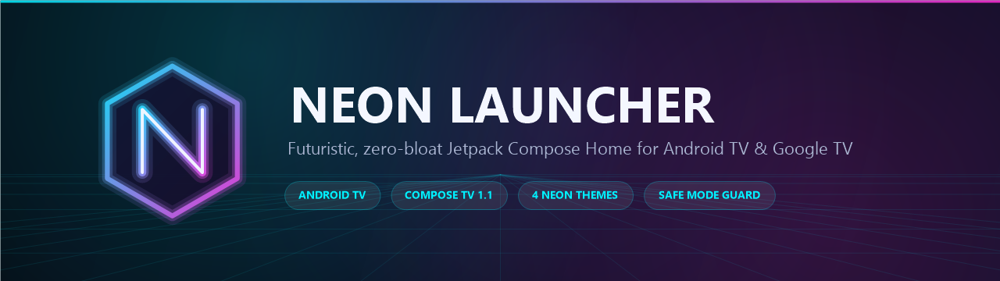
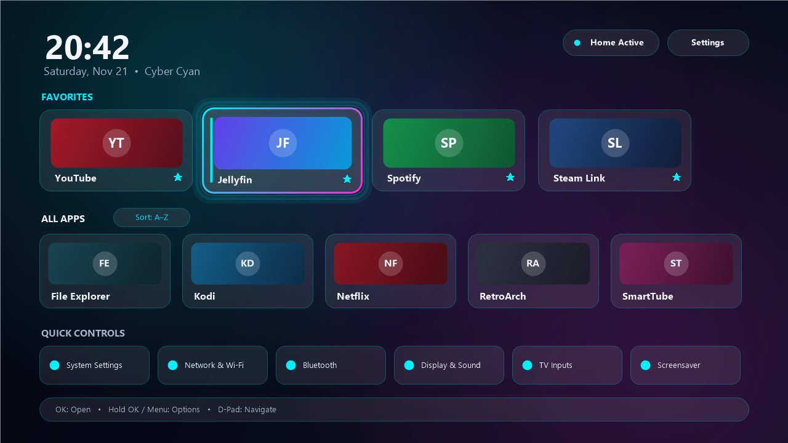
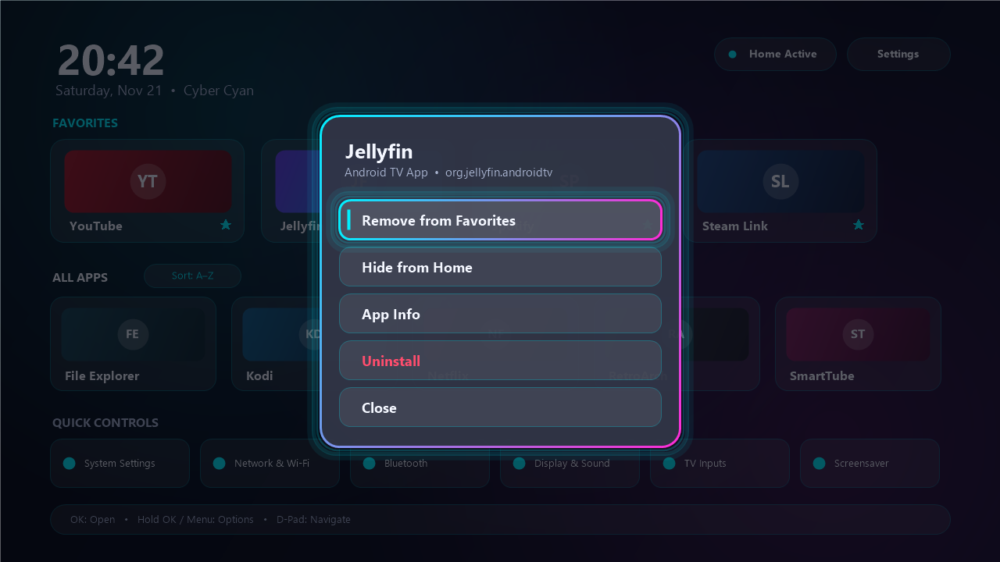
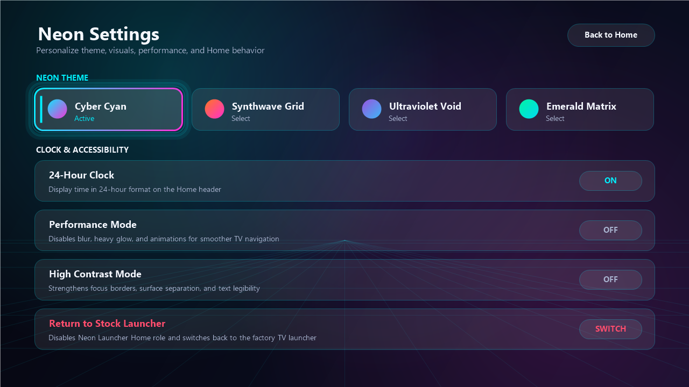

<div align="center">



# Neon Launcher

**Launcher abierto, rápido y privado para Android TV y Google TV, diseñado para el control remoto (D-pad).**

[English](README.md) | **Español**

[](LICENSE)
[](SECURITY.md)
[](docs/COMPATIBILITY.md)
[](#permisos-y-privacidad)

</div>

> [!IMPORTANT]
> **Aviso de estado verificado vs. pendiente de verificación**
>
> - **Verificado localmente (compilación y análisis estático)**: `./gradlew lint test assembleDebug assembleRelease` (0 errores de lint, 11/11 pruebas unitarias aprobadas), APK universal único debug y release (`arm64-v8a`, `armeabi-v7a`, `x86`, `x86_64`, sin código nativo NDK/C++), auditoría de dependencias (0 GMS, Firebase, Play Store ni SDKs de red), auditoría de manifiesto y permisos, paridad EN/ES (115 claves) y pruebas `--dry-run` / `-DryRun` de los scripts. La tipografía usa el respaldo del sistema `SansSerif` con tracking amplio (los `.ttf` estáticos OFL de Orbitron/Exo 2 devolvieron 404 en `google/fonts/main`).
> - **Sin verificar / Pendiente**: **La ejecución en televisores físicos Android TV, Google TV, Fire TV y en emuladores Android TV (720p/1080p/4K, navegación D-pad en vivo, cambio de HOME predeterminado y disparo real del Modo Seguro) aún no ha sido probada** (no había imágenes de emulador Android TV instaladas localmente). Consulta [`docs/COMPATIBILITY.md`](docs/COMPATIBILITY.md) para enviar un reporte anonimizado.

---

## Vista previa visual *(Maquetas UI renderizadas)*

> [!NOTE]
> Las siguientes imágenes son **maquetas UI renderizadas** que muestran el diseño previsto de Neon Launcher, no capturas reales tomadas desde un televisor físico.

| Pantalla de inicio *(Maqueta renderizada)* | Menú contextual de app *(Maqueta renderizada)* |
| :---: | :---: |
|  |  |

| Ajustes de Neon *(Maqueta renderizada)* |
| :---: |
|  |

---

## Características principales

- **Navegación D-Pad nativa para TV**:
  - `OK` / `DPAD_CENTER` — Abre al instante la aplicación o control rápido enfocado.
  - `Mantener OK` o botón `Menú` — Abre **Opciones de app** (Fijar en Favoritos, Ocultar del inicio, Información de la app, Desinstalar).
  - `Atrás (Back)` — **Nunca cierra** el launcher ni te deja en una pantalla vacía estando en el inicio.
- **Protección antiatrapamiento (Anti-Trap)**:
  - **Volver al launcher original**: Opción directa dentro de **Ajustes de Neon** que desactiva `dev.neonlauncher/.HomeAlias` y devuelve el inicio de fábrica usando solo el control remoto.
  - **Modo Seguro tras 3 fallos en 2 minutos**: Si el launcher falla 3 veces seguidas en menos de 2 minutos, pausa automáticamente su alias de inicio y muestra una pantalla de recuperación para restablecer ajustes, continuar manualmente o reactivar el inicio.
- **Motor de temas JSON y efectos**:
  - Temas neón oscuros con estilos de fondo `AURORA`, `GRID` (Rejilla Cyber) y `SOLID` (Sólido), **Modo rendimiento** para TV sticks de poca RAM y **Modo alto contraste**.
  - Incluye el **Salvapantallas Neon Aurora** (`DreamService`).
- **Bilingüe de serie**: Interfaz y documentación en **Español** e **Inglés**.

---

## Permisos y privacidad

Neon Launcher funciona **100 % sin conexión por diseño**:

| Capacidad / Permiso | Estado | Propósito |
| ------------------- | ------ | --------- |
| `android.permission.REQUEST_DELETE_PACKAGES` | **Solicitado** | Muestra el diálogo oficial de confirmación de Android cuando eliges **Desinstalar** en el menú de una app. Nunca desinstala en silencio. |
| `<queries>` (visibilidad Android 11+) | **Declarado** | Limitado únicamente a apps iniciables (`MAIN`/`LAUNCHER`, `LEANBACK_LAUNCHER`), launchers `HOME`, entradas/canales de TV y accesos del sistema (`WIFI`, `BLUETOOTH`, `DISPLAY`, `DREAM`, `HOME`, info de app). |
| `android.permission.INTERNET` | **CERO (No solicitado)** | La aplicación **no tiene permiso de red** y no puede enviar ni recibir datos. |
| `android.permission.QUERY_ALL_PACKAGES` | **CERO (No solicitado)** | Sin acceso indiscriminado a toda la lista de paquetes internos. |
| GMS / Firebase / Telemetría / Anuncios | **CERO (Ninguno)** | Cero Google Mobile Services, cero SDKs de analítica, cero envío de fallos, cero publicidad. |

---

## Instalación rápida

> [!TIP]
> Consulta [`docs/INSTALL.md`](docs/INSTALL.md) para ver la guía detallada paso a paso, los niveles recomendados de inicio predeterminado (de menos a más invasivo) y la recuperación manual.

### Opción 1: App "Downloader" en el TV (sin PC)

1. Instala **Downloader** en tu televisor y activa **"Instalar aplicaciones desconocidas"** para Downloader en los Ajustes del TV.
2. Escribe la URL directa de la última versión (o un acortador de confianza que apunte exactamente a ella):

   ```text
   https://github.com/OWNER/REPO/releases/latest/download/neon-launcher.apk
   ```

3. Instala la app y pruébala desde tu fila de Aplicaciones antes de configurarla como pantalla de inicio predeterminada.

### Opción 2: Desde PC por ADB (`scripts/install`)

Usa los scripts no destructivos del repositorio (previsualiza primero con `--dry-run` / `-DryRun`, verifican SHA-256 e imprimen el comando de desinstalación antes de actuar):

```bash
# Linux / macOS
./scripts/install.sh <IP_DEL_TV> --dry-run
./scripts/install.sh <IP_DEL_TV>
```

```powershell
# Windows PowerShell (si tu sistema bloquea scripts, antepón: powershell -ExecutionPolicy Bypass -File ...)
.\scripts\install.ps1 <IP_DEL_TV> -DryRun
.\scripts\install.ps1 <IP_DEL_TV>
```

### Opción 3: Memoria USB + Explorador de archivos en el TV

Descarga `neon-launcher.apk` y `neon-launcher.apk.sha256` desde el [último release](https://github.com/OWNER/REPO/releases/latest), verifica el hash en tu PC (`sha256sum -c neon-launcher.apk.sha256`), copia `neon-launcher.apk` a una memoria USB e instálalo desde un explorador de archivos en el TV.

---

## Compila tu propio APK sin Android Studio

**No** necesitas Android Studio ni conocimientos de programación para generar tu propio APK usando GitHub Actions:

1. **Haz un Fork del repositorio**: Pulsa el botón **Fork** arriba a la derecha en GitHub para copiar el repositorio a tu cuenta.
2. **Ve a la pestaña `Actions` y habilita los workflows**: GitHub **desactiva los flujos de trabajo en los forks por defecto** por seguridad. Entra en la pestaña **Actions** de tu fork y pulsa **"I understand my workflows, go ahead and enable them"**.
3. **Ejecuta manualmente el workflow `Build`**: Selecciona **`Build`** en el menú izquierdo, pulsa **`Run workflow`** (`workflow_dispatch`) manteniendo la rama `main` y confirma.
4. **Descarga el artefacto APK**: Cuando termine con marca verde, abre la ejecución, baja hasta **Artifacts** y descarga **`neon-launcher-debug-apk`** (descomprime el `.zip` para obtener `app-debug.apk`).

---

## Firma de releases y actualizaciones

- **Con secretos de Keystore configurados**: Si quien mantiene el repositorio configura los 4 secretos (`KEYSTORE_BASE64`, `KEYSTORE_PASSWORD`, `KEY_ALIAS`, `KEY_PASSWORD`) — ver [`scripts/generate-keystore.sh`](scripts/generate-keystore.sh) / [`.ps1`](scripts/generate-keystore.ps1) — el workflow `Release` firma `neon-launcher.apk` con la misma clave para que las futuras actualizaciones se instalen sin perder datos ni configuraciones.
- **Firma de respaldo (`SIGNING_MODE=debug-fallback`)**: Si esos secretos **no** están configurados (por ejemplo, en un fork nuevo), el workflow `Release` sigue completándose usando firma `debug-fallback` y añade un aviso en las notas del release. Como Android exige que las actualizaciones coincidan en firma, al cambiar entre builds debug diferentes o entre firma debug y release habrá que desinstalar primero:

  ```bash
  adb uninstall dev.neonlauncher
  ```

---

## Base técnica

| Propiedad | Valor |
| --------- | ----- |
| ID de aplicación / Paquete | `dev.neonlauncher` |
| Actividad principal | `dev.neonlauncher/.MainActivity` |
| Alias de inicio (HOME) | `dev.neonlauncher/.HomeAlias` |
| Archivo APK de release | `neon-launcher.apk` + `neon-launcher.apk.sha256` |
| SDK mínimo | `minSdk 23` (Android 6.0 Marshmallow — el nivel más bajo compatible con la base Jetpack Compose / AndroidX de 2026) |
| SDK de compilación / destino | `compileSdk 37` / `targetSdk 37` |

---

## Documentación y comunidad

- [`README.md`](README.md) — Full English documentation
- [`docs/INSTALL.md`](docs/INSTALL.md) — Guía de instalación, niveles de inicio predeterminado y recuperación manual
- [`docs/COMPATIBILITY.md`](docs/COMPATIBILITY.md) — Plataformas objetivo, matriz ADB por versión de Android y tabla de dispositivos verificados
- [`docs/TROUBLESHOOTING.md`](docs/TROUBLESHOOTING.md) — Solución a botón Inicio atascado, Modo Seguro, apps faltantes, errores ADB y conflictos de firma
- [`docs/THEMING.md`](docs/THEMING.md) — Esquema JSON de temas, contraste WCAG y validación con pruebas
- [`docs/TRANSLATING.md`](docs/TRANSLATING.md) — Cómo añadir traducciones en `strings.xml` y guía RTL
- [`CONTRIBUTING.md`](CONTRIBUTING.md) · [`SECURITY.md`](SECURITY.md) · [`CODE_OF_CONDUCT.md`](CODE_OF_CONDUCT.md) · [`CHANGELOG.md`](CHANGELOG.md) · [`LICENSE`](LICENSE)
