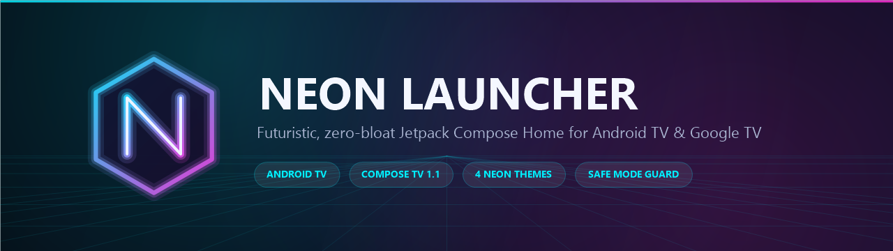
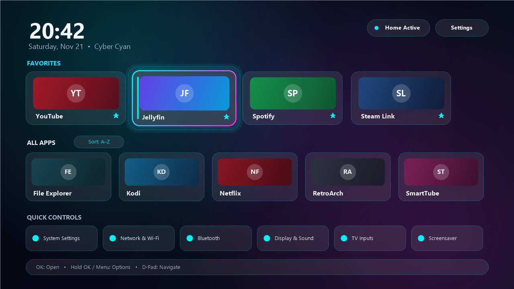
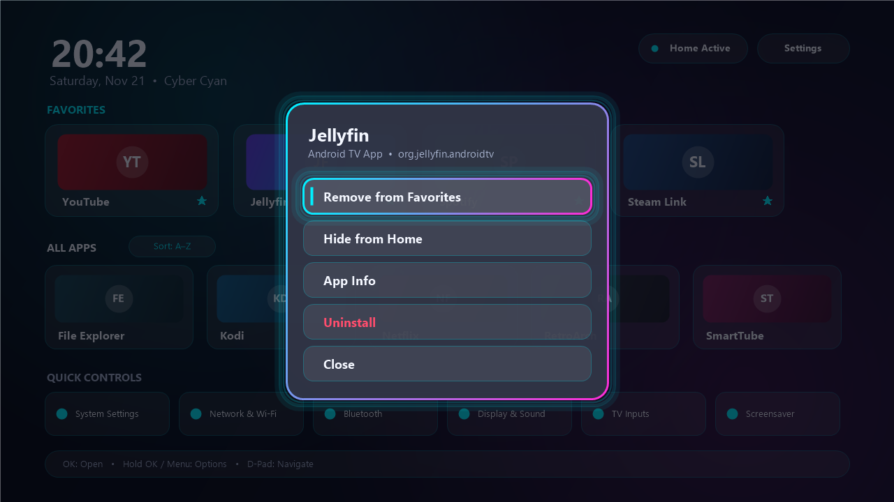
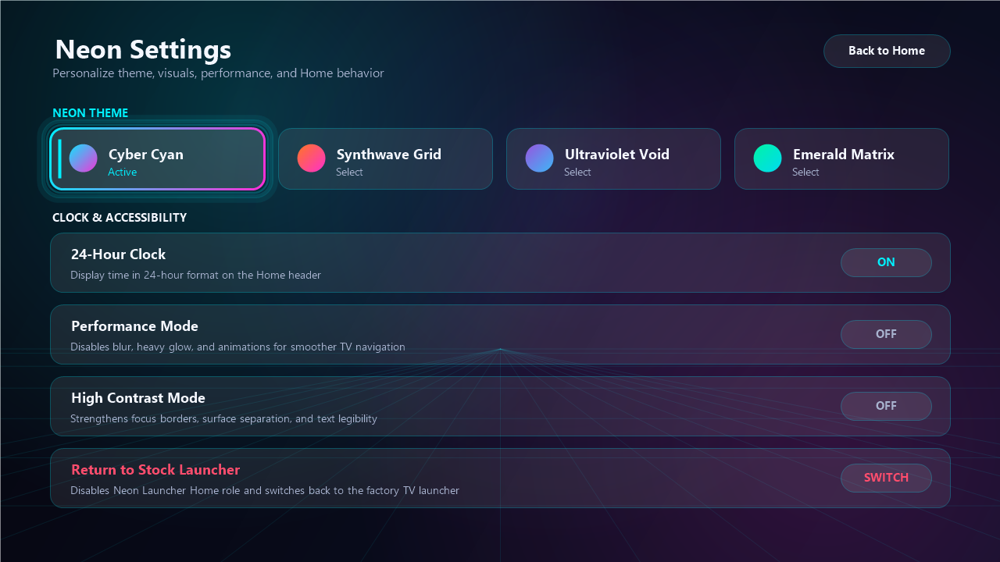

<div align="center">



# Neon Launcher

**A fast, privacy-first, open-source Android TV & Google TV launcher built for D-pad navigation.**

**English** | [Español](README.es.md)

[](LICENSE)
[](SECURITY.md)
[](docs/COMPATIBILITY.md)
[](#permissions--privacy)

</div>

> [!IMPORTANT]
> **Verified vs. Unverified Status Notice**
>
> - **Verified locally (build & static checks)**: `./gradlew lint test assembleDebug assembleRelease` (0 lint errors, 11/11 unit tests passing), single universal debug & release APKs (`arm64-v8a`, `armeabi-v7a`, `x86`, `x86_64`, zero NDK/C++ code), `debugRuntimeClasspath` dependency audit (0 GMS, Firebase, Play Store, or network SDKs), manifest & permission audit, EN/ES string parity (115 keys), and `--dry-run` / `-DryRun` script checks. Typography uses the system `SansSerif` fallback with wide geometric tracking (static OFL `.ttf` files for Orbitron/Exo 2 returned 404 on `google/fonts/main`).
> - **Unverified / Pending**: **Runtime behavior on physical Android TV, Google TV, Fire TV hardware, and Android TV emulators (including 720p/1080p/4K rendering, live D-pad navigation, default HOME switching, and live Safe Mode triggers) has not been executed yet** (no Android TV emulator image was present locally). See [`docs/COMPATIBILITY.md`](docs/COMPATIBILITY.md) for how to test and submit a sanitized compatibility report.

---

## Visual Preview *(Rendered UI Mockups)*

> [!NOTE]
> The images below are **rendered UI mockups** illustrating Neon Launcher's visual design and layout, not live photographs from TV hardware.

| Home Screen *(Rendered Mockup)* | App Options Context Menu *(Rendered Mockup)* |
| :---: | :---: |
|  |  |

| Neon Settings *(Rendered Mockup)* |
| :---: |
|  |

---

## Features

- **D-Pad First TV Experience**:
  - `OK` / `DPAD_CENTER` — Launch the focused app or quick control immediately.
  - `Hold OK` (long press) or `Menu` — Open **App Options** (Pin to Favorites, Hide from Home, App Info, Uninstall).
  - `Back` — **Never exits** the launcher or drops you onto a blank screen when at Home.
- **Anti-Trap Safety Safeguards**:
  - **Return to Stock Launcher**: One-click recovery inside **Neon Settings** disables `dev.neonlauncher/.HomeAlias` so your TV falls back to the factory launcher—no PC required.
  - **3-Crash-in-2-Minute Safe Mode**: Automatic crash-loop protection detects 3 crashes within 2 minutes, pauses `HomeAlias`, and presents a recovery screen to reset settings, continue manually, or re-enable Home.
- **Customizable JSON Themes & Effects**:
  - Built-in dark neon themes supporting `AURORA`, `GRID`, and `SOLID` background styles, **Performance Mode** for low-RAM TV sticks, and **High Contrast Mode**.
  - Includes an ambient **Neon Aurora Screensaver** (`DreamService`).
- **Bilingual Out of the Box**: Complete **English** and **Spanish** UI and documentation.

---

## Permissions & Privacy

Neon Launcher is strictly **offline by design**:

| Capability / Permission | Status | Purpose |
| ----------------------- | ------ | ------- |
| `android.permission.REQUEST_DELETE_PACKAGES` | **Requested** | Opens the standard Android system confirmation dialog when you choose **Uninstall** from an app's options menu. Cannot uninstall silently. |
| `<queries>` (Android 11+ visibility) | **Declared** | Scoped strictly to launchable apps (`MAIN`/`LAUNCHER`, `LEANBACK_LAUNCHER`), `HOME` launchers, TV inputs/channels, and system Settings shortcuts (`WIFI`, `BLUETOOTH`, `DISPLAY`, `DREAM`, `HOME`, app details). |
| `android.permission.INTERNET` | **ZERO (Not Requested)** | The app has **no network permission** and cannot send or receive data. |
| `android.permission.QUERY_ALL_PACKAGES` | **ZERO (Not Requested)** | No unrestricted package inventory snooping. |
| GMS / Firebase / Telemetry / Ads | **ZERO (None Included)** | Zero Google Mobile Services, zero analytics SDKs, zero crash-reporting uploads, zero ads. |

---

## Quick Install

> [!TIP]
> Always read [`docs/INSTALL.md`](docs/INSTALL.md) for the full beginner walkthrough, including least-to-most-invasive default HOME setup and safe rollback instructions.

### Option 1: TV "Downloader" App (No PC Needed)

1. Install **Downloader** on your TV and allow **"Install unknown apps"** for Downloader in TV Settings.
2. Enter the release download URL (or a trusted URL shortener pointing directly to it):

   ```text
   https://github.com/OWNER/REPO/releases/latest/download/neon-launcher.apk
   ```

3. Install and test Neon Launcher from your Apps row first before setting it as your default HOME screen.

### Option 2: PC via ADB (`scripts/install`)

Use the non-destructive helper scripts (preview first with `--dry-run` / `-DryRun`, SHA-256 verified, prints rollback command before acting):

```bash
# Linux / macOS
./scripts/install.sh <TV_IP> --dry-run
./scripts/install.sh <TV_IP>
```

```powershell
# Windows PowerShell (if script execution is restricted, prefix with: powershell -ExecutionPolicy Bypass -File ...)
.\scripts\install.ps1 <TV_IP> -DryRun
.\scripts\install.ps1 <TV_IP>
```

### Option 3: USB Flash Drive + TV File Explorer

Download `neon-launcher.apk` and `neon-launcher.apk.sha256` from the [latest release](https://github.com/OWNER/REPO/releases/latest), verify the checksum on your PC (`sha256sum -c neon-launcher.apk.sha256`), copy `neon-launcher.apk` to a USB drive, and install it via a file manager on your TV.

---

## Build Your Own APK Without Android Studio

You do **not** need Android Studio or any programming tools to build a fresh APK yourself using GitHub's cloud runners:

1. **Fork this repository**: Click the **Fork** button in the top-right corner of this GitHub repository to copy it to your own account.
2. **Open the `Actions` tab and enable workflows**: GitHub **disables workflows on forked repositories by default** for security. Go to the **Actions** tab in your fork and click **"I understand my workflows, go ahead and enable them"**.
3. **Run the `Build` workflow manually**: Click **`Build`** in the left sidebar, click **`Run workflow`** (`workflow_dispatch`), keep the default branch (`main`), and confirm **Run workflow**.
4. **Download your APK artifact**: Once the job finishes with a green checkmark, click the completed run, scroll down to **Artifacts**, and download **`neon-launcher-debug-apk`** (extract the `.zip` to get `app-debug.apk`).

---

## Release Signing & Updating

- **Release Keystore Configured**: When repository maintainers configure the 4 signing secrets (`KEYSTORE_BASE64`, `KEYSTORE_PASSWORD`, `KEY_ALIAS`, `KEY_PASSWORD`) — see [`scripts/generate-keystore.sh`](scripts/generate-keystore.sh) / [`.ps1`](scripts/generate-keystore.ps1) — the `Release` workflow signs `neon-launcher.apk` with a consistent certificate so future updates install seamlessly over older versions.
- **Debug-Fallback Signing (`SIGNING_MODE=debug-fallback`)**: If those signing secrets are **not** configured (such as on a fresh fork), the `Release` workflow still succeeds using debug-fallback signing and adds a notice in the release notes. Because Android rejects updates when signing certificates differ, upgrading between different debug-fallback builds or switching between debug and release APKs requires uninstalling first:

  ```bash
  adb uninstall dev.neonlauncher
  ```

---

## Technical Baseline

| Property | Value |
| -------- | ----- |
| Application ID / Package | `dev.neonlauncher` |
| Main Activity | `dev.neonlauncher/.MainActivity` |
| HOME Alias | `dev.neonlauncher/.HomeAlias` |
| Release APK Asset | `neon-launcher.apk` + `neon-launcher.apk.sha256` |
| Minimum SDK | `minSdk 23` (Android 6.0 Marshmallow — lowest compatible with the 2026 Jetpack Compose / AndroidX baseline) |
| Compile / Target SDK | `compileSdk 37` / `targetSdk 37` |

---

## Documentation & Community

- [`README.es.md`](README.es.md) — Documentación completa en español
- [`docs/INSTALL.md`](docs/INSTALL.md) — Step-by-step installation, default HOME levels (non-destructive vs last-resort), and manual recovery
- [`docs/COMPATIBILITY.md`](docs/COMPATIBILITY.md) — Target platforms, ADB command matrix by Android version, and verified device list
- [`docs/TROUBLESHOOTING.md`](docs/TROUBLESHOOTING.md) — Stuck HOME fixes, Safe Mode recovery, missing banners, ADB setup, signature conflicts
- [`docs/THEMING.md`](docs/THEMING.md) — JSON theme schema, WCAG contrast guidelines, and validation tests
- [`docs/TRANSLATING.md`](docs/TRANSLATING.md) — Adding `strings.xml` translations and RTL guidelines
- [`CONTRIBUTING.md`](CONTRIBUTING.md) · [`SECURITY.md`](SECURITY.md) · [`CODE_OF_CONDUCT.md`](CODE_OF_CONDUCT.md) · [`CHANGELOG.md`](CHANGELOG.md) · [`LICENSE`](LICENSE)
